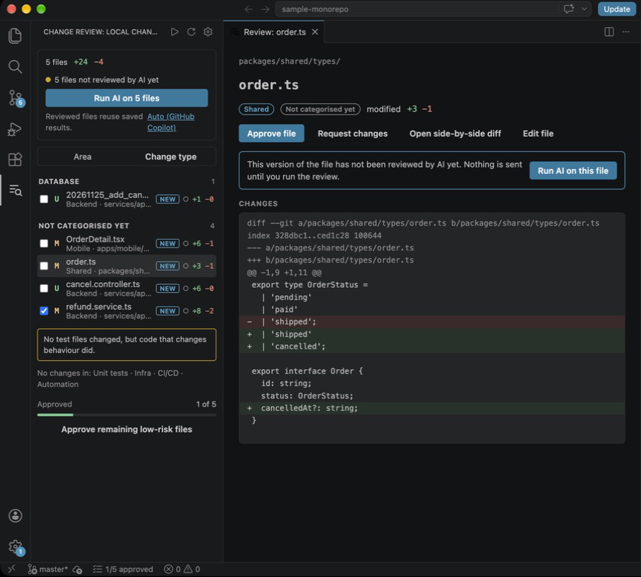

# ReviewLens

Understand and approve AI-written code changes, file by file.

When an AI agent changes many files at once, ReviewLens lists what changed, groups it by area of your repo or by type of change, and, when you ask, explains **why** each file changed, **what** changed and **what it might affect**. You approve or request changes per file, right in the editor. It works on your **local uncommitted changes** and on **GitHub pull requests** and **GitLab merge requests**.

Works in **VS Code** and **Cursor**. AI only runs when you press the button.

> **Preview.** An early release. File approvals stay in the editor; comments, replies and your overall review are posted to GitHub or GitLab when you choose.



## Features

- **All your uncommitted changes in one list:** staged, unstaged and new files, with added and removed line counts.
- **Group by area or by change type.** Areas come from path prefixes you set, such as `apps/mobile/` or `services/`, which suits monorepos. Change types include UI, business logic, API, shared types, database, tests, infra, CI/CD, automation, config and docs.
- **Spots missing tests:** warns when code that changes behaviour changed but no test files did.
- **AI explanations on demand:** for each file, why it changed, what changed, possible impact with a risk level, and the diff.
- **Approve per file:** tick a file in the list, or use **Approve file** / **Request changes** in its review. An approval clears automatically if the file changes afterwards. The status bar shows how many files are approved.
- **Your team's review rules and skills:** write rules (for example "no personal data in logs") and review playbooks (for example a security checklist) as Markdown files in `.reviewlens/`. The AI checks every matching file against them and lists each broken rule as a finding on the file.
- **Uses the AI you already have:** GitHub Copilot in VS Code, or the Cursor agent or Claude Code CLI. No extra account or API key needed.
- **Pull and merge requests:** open PRs from GitHub or MRs from GitLab (including self-hosted), with the ones waiting for your review first. Their files are grouped into the same area lanes, and the AI also reads the PR's title and description.
- **Comments, as on GitHub and GitLab:** each file's review shows the PR's comment threads under the lines they're on. Comment on a line with **+**, reply, and resolve or reopen threads; they post to GitHub or GitLab like any other comment.
- **Post your review:** see where each reviewer stands (approved, changes requested, commented, waiting), then **Approve**, **Request changes** or **Comment** on the PR, optionally with a file-by-file summary of your approvals. You confirm before anything is posted.
- **Notifications on Refresh:** press **Refresh** to get the latest comments, reviews and commits. It also tells you about new review requests for you, and new comments, approvals and change requests from others on your own PRs. Nothing is checked in the background.

## Getting started

1. Open a folder that is a Git repository and click **ReviewLens** in the activity bar.
2. Browse your changes. Nothing is sent to any AI yet.
3. Click **Run AI on N files**, or run **ReviewLens: Run AI review** from the command palette.
4. Click a file to read its review, then approve it or request changes.

### Reviewing a pull or merge request

1. In the ReviewLens panel, switch to the **Pull requests** tab (**Merge requests** on GitLab). ReviewLens uses your repository's `origin` remote to find the project.
2. Sign in:
   - **GitHub:** click **Sign in to GitHub** to use your editor's GitHub account, or **Use a personal access token**. A fine-grained token needs **Pull requests: read and write** and **Contents: read** (read-only works for reading, but not for posting).
   - **GitLab:** click **Add a GitLab access token** and paste a personal access token with the `api` scope (`read_api` only lets you read). For a self-hosted server whose name doesn't contain "gitlab", add it to `reviewLens.gitlabHosts`.
3. Pick a pull or merge request, then run the AI review and approve file by file as for local changes.
4. In a file's review, read and answer teammates' comments, or click **+** next to a line to add one.
5. Back in the panel, post your review with **Approve**, **Request changes** or **Comment**. Press **Refresh** whenever you want the latest comments, reviews and commits.

GitHub doesn't let you approve your own pull request. GitLab's API has no "request changes" call, so **Request changes** on GitLab removes your approval (if you gave one) and posts your comment.

Tokens are kept in the editor's secure storage. **ReviewLens: Remove saved access token** deletes them.

### Choosing the AI

Set `reviewLens.backend`:

| Value | Uses | Needs |
|---|---|---|
| `auto` (default) | Copilot in VS Code, the Cursor agent in Cursor | See below |
| `copilot` | GitHub Copilot through VS Code's language model API | Copilot installed and signed in; VS Code asks once for permission. Not available in Cursor. |
| `cursor` | The Cursor agent CLI (`agent`) | [Cursor CLI](https://cursor.com/docs/cli) installed and signed in, and the repository trusted in it (see below) |
| `claude` | The Claude Code CLI (`claude`) | Claude Code installed and signed in |

The Cursor agent asks once per folder whether you trust it, and can't ask during a review. The first time you review a repository with it, ReviewLens says so and offers **Open in terminal**: it starts the agent in the repository, you choose to trust the folder, exit, and run the review again. ReviewLens never trusts a folder for you, because a trusted folder lets the agent run code there.

## Review rules and skills

Tell the AI what your team cares about. Rules and skills are Markdown files in the repository, so they're versioned and shared with everyone who reviews it. Run **ReviewLens: Review rules and skills** (or click **Manage** under the Run button) to see them, turn them off, or create one from a template.

| What | Where | Use it for |
|---|---|---|
| **Rule** | `.reviewlens/rules/<name>.md` | A short check every matching change must pass. Each break is listed as a finding with a level and, when possible, a line. |
| **Skill** | `.reviewlens/skills/<name>/SKILL.md` | A longer review playbook, such as a security or accessibility checklist. Same format as Claude Code and Cursor skills, so you can reuse yours. |
| **Personal rule** | `reviewLens.personalRules` setting | One-line rules just for you, applied to every file in every repository. |

A rule file is plain Markdown with optional frontmatter:

```markdown
---
description: No personal data in logs
globs: ["services/**", "apps/api/**"]   # optional: only these files (no globs = every file)
severity: high                          # high, medium (default) or low
---

Don't log emails, phone numbers, addresses, access tokens or full request bodies.
Log ids instead.
```

Skills take `name`, `description` and optional `globs`. Add `enabled: false` to keep a file but stop using it.

- Each file is checked only against the rules whose `globs` match it, and only those rules are sent, so rules for other areas cost nothing.
- A file's risk is at least as high as its highest finding. Files with findings show **⚑** in the list; the file's review has a **Review rules** card with each finding, or a ✓ when it follows them all.
- When you add or change a rule, only the files it covers need a new AI review; saved results for the rest are kept.
- Rules are read from your local working tree, never from the pull or merge request, so a PR can't change the rules it is reviewed against. (If you check out the PR's branch locally, its `.reviewlens/` folder is what you get.)
- Rules guide the review only: the AI is told to ignore anything in them that asks it to edit files, run commands or change its reply format.

## Cursor plugin

This repository is also an [Agent Plugins](https://agent-plugins.org) plugin for Cursor's agent. It brings the same explanation-first review to chat, without the panel:

| Component | What it does |
|---|---|
| `/review-changes` command and `review-changes` skill | Reviews your uncommitted changes: why each file changed, what changed, possible impact and risk, grouped by area, with a missing-tests warning and an approval checklist. Read-only. |
| `/review-pr` command and `review-pull-request` skill | Reviews a GitHub pull request or GitLab merge request (with the `gh` or `glab` CLI) in lanes by area, with teammates' open threads, reviewer status and drafted comments. Posts only when you say so. |
| `explain-ai-changes` rule | When the agent changes three or more files, it ends with a per-file summary for review. |

The plugin's files are `plugin.json`, `skills/`, `commands/` and `rules/`. They aren't part of the editor extension package.

## Keeping AI usage low

- AI never runs on its own: only when you press the button or run the command.
- Results are saved per version of each file, so files you have already reviewed aren't sent again.
- Only the changed sections plus a few lines of context are sent, not whole files.
- All files go in one request per review.
- Lockfiles, binary files, deleted files and build output are never sent.
- You're asked first when a review would be larger than `reviewLens.askBeforeTokens`.

## Privacy

When you run a review, the changed sections of your files (and their paths) are sent to the AI backend you chose: GitHub Copilot, Cursor or Claude Code, under that provider's terms. For a pull or merge request, its title and description are sent too. Your review rules and skills that apply to the files being reviewed are sent too. Nothing is sent until you run a review, and the extension itself collects no telemetry. Saved results and approvals stay in your editor's workspace storage.

For pull and merge requests, ReviewLens reads from the GitHub or GitLab API with your sign-in or token, only when you open the tab or press Refresh. It posts only what you send: a comment, a reply, a thread resolve, or a review you confirm.

## Settings

Click the gear in the ReviewLens panel, or run **ReviewLens: Settings**, to change these from a quick menu. You can also edit them in your editor's settings.

| Setting | Default | What it does |
|---|---|---|
| `reviewLens.backend` | `auto` | Which AI runs the review (see above) |
| `reviewLens.cursorCommand` | `agent` | Command or full path for the Cursor agent CLI |
| `reviewLens.claudeCommand` | `claude` | Command or full path for the Claude Code CLI |
| `reviewLens.contextLines` | `10` | Lines of context sent around each change |
| `reviewLens.askBeforeTokens` | `50000` | Ask before sending a bigger review |
| `reviewLens.maxFileDiffChars` | `20000` | Shorten a single file's changes above this size |
| `reviewLens.timeoutSeconds` | `300` | Give up on a CLI backend after this long |
| `reviewLens.useRules` | `true` | Check changes against your review rules and skills |
| `reviewLens.personalRules` | none | Your own one-line review rules, applied to every file |
| `reviewLens.areas` | Mobile / Web / Backend / Shared | Path prefixes that define your repo's areas |
| `reviewLens.gitlabHosts` | none | Self-hosted GitLab servers whose names don't contain "gitlab" |
| `reviewLens.notifications.enabled` | `true` | On Refresh, tell you about new review requests and about others' comments and reviews on your PRs |

## Known limitations

- Per-file approvals stay in the editor; only your overall review is posted.
- Comments are on lines of the diff; file-level comments can be read but not started from the editor.
- Comments and reviews don't update by themselves: press **Refresh**.
- GitHub Enterprise Server isn't supported yet (github.com only).
- Very large files in a pull request come without their diff from GitHub/GitLab, so they can't be reviewed by AI in the editor.
- In local changes, renamed files show as a deleted file plus a new file.
- With a CLI backend, the CLI must be installed and signed in on your machine.

## Roadmap

Applying teammates' suggested changes in the editor; code owners per lane; proof attachments (screenshots and recordings); an own-API-key backend; and chat tools over MCP. See the [concept](docs/CONCEPT.md) and the [mockups](mockups).

## Building from source

```bash
git clone https://github.com/michaeljude/reviewlens.git
cd reviewlens
npm install
npm test
npm run package
```

`npm run package` builds a `.vsix` you can install with **Extensions: Install from VSIX…**. To work on the extension, open the folder and press **F5**.

## License

[MIT](LICENSE)
